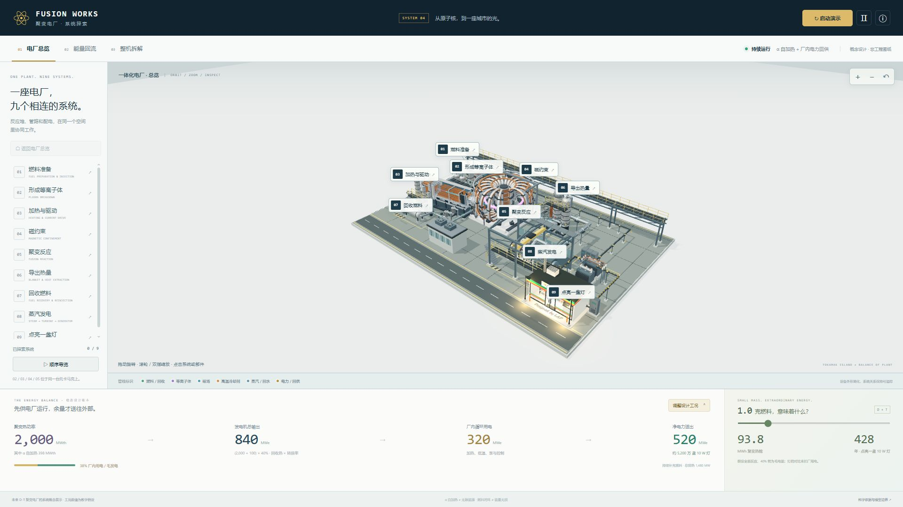
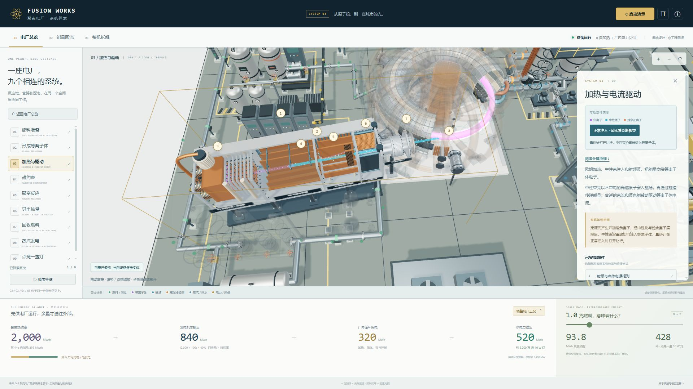
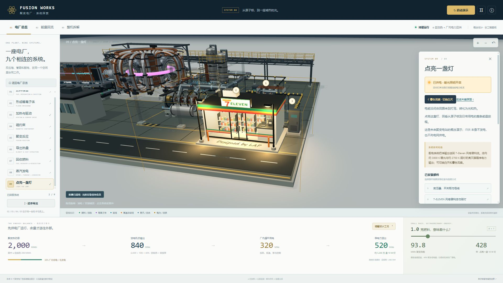

# FUSION WORKS · 聚变电厂系统探索 V4

这是一次整厂重构：九个学习步骤现在对应同一座相互连接的聚变电厂，中央反应机组与燃料、真空加热、冷却、回收、汽轮机、配电及外部负载共用同一个三维空间。

**[在线体验：lapgym.cn/fusion](https://www.lapgym.cn/fusion/)** · 设计与制作：LAP

## 项目画面

### 一体化电厂总览

### 中性束注入装置

### 暮色中的便利店

## 打开

双击 **聚变电厂_一体化.html**，使用支持 WebGL 的新版 Edge、Chrome、Firefox 或 Safari。库、环境光、模型、样式、说明与计算均已包含，可离线运行。`聚变之旅.html` 是相同新版内容的兼容入口。

开发时运行 `npm start`，打开 http://127.0.0.1:4173 。`dist/` 也可交给静态服务器托管。

## 本版新增

- **视线而非只有取景范围**：根据实际目标表面比较观察角度，并自动透视前景遮挡；转动镜头后重新检查，可关闭自动透视。当前目标保持实体，返回总览恢复材质与阴影。
- **独立的人行前场与道路**：便利店退后，路缘、灯柱和前场退出车道，移除车道内停车挡块。
- **店外接线柜**：送出电缆沿店外通道抵达独立接线柜，再经短导管接入侧墙密封接口；流动标记遵循同一实物折线。
- **门口署名**：人行前场上的艺术英文 Designed by LAP，离线生成，深色笔迹与暖光铺装保持清晰对比。

以下保留 V3 的束线、原理和暖光能力：

- **查证后的束线**：以 ITER / MITICA 负离子中性束方案重做束源、加速栅、中性化器、静电残余离子吸收器、可开合量热计与切向漂移管。中性束沿直线；带电剩余粒子才偏转至吸收板。可以切换正常注入与诊断截束。
- **部件观察**：每个部件可扩展独立镜头方向，自动避开说明面板；镜头就位后沿选中实物闪亮两次。减少动态效果模式用静态强调。手机选择部件后自动回到模型位置。
- **20 张关键原理卡**：击穿、欧姆热、束流电离与减速、洛伦兹力、D–T 反应、质能关系、自加热、热交换、燃料与电力回路、感应发电和 LED；公式和官方来源可直接阅读。
- **暖光便利店**：7‑Eleven 风格玻璃门店，含货架商品、收银台、室内灯和街灯。第九步默认暮色，也能切回白天；灯具、光晕、地面光斑跟随正净输出和发电机状态，净输出不足则熄灭。

以下保留 V2 的整厂能力：

- **工业整厂**：分层托卡马克剖切、D 形磁体、中心螺线管、包层瓦块、法兰螺栓、偏滤器、波纹管、检修平台、管桥、汽轮机厂房、吊车、变压器、机柜、阀组与道路照明。约 6,000 个重复硬件实例；设备比例与外形仍为教学概念设计。
- **实际连接**：12 条实体管路/电缆路线；主冷却回路、蒸汽与冷凝回水、燃料回收、电厂内部回供、电网送出分别可追踪。学习编号中的多个步骤位于同一台托卡马克中。
- **三种观察模式**：电厂总览、能量回流、整机拆解。选择系统时保留周围设备；32 个唯一物理部件可进一步检查，也可选择“单独观察部件”。拆解与重新组装连续可逆。
- **两种能量支持路径**：α 粒子在等离子体内沉积能量；发电机的一部分输出回供加热、低温、泵和控制。冷启动展示外部电网供能，再建立反应和发电回供。
- **可计算的规模**：稳态功率账本、可调聚变热功率/辅助加热/热电效率、正/零/负净发电工况、燃料质量与照明年数对比。

默认教学工况：2,000 MW 聚变热 + 100 MW 辅助加热，被回收为 2,100 MW 热；40% 毛发电得到 840 MWe。加热设备消耗 200 MWe，其他厂用电 120 MWe，因此净输出 520 MWe，约相当于 5,200 万盏 10 W 灯。

α 自加热约 398 MW，是 2,000 MW 聚变热功率的一部分，不能再加一次。默认总排热为 1,480 MW，满足“净输出 + 总排热 = 聚变热功率”。启动阶段数值仅表示阶段示意，底部始终是所选稳态设计账本。

1 克完全反应的等核数氘氚混合燃料约释放 93.78 MWh 热；40% 转换时约产生 37.51 MWh 毛电，能让单盏 10 W 灯亮约 428 年。此比较未扣厂用电，也不代表实际装置能把注入燃料全部燃烧。

## 操作

拖动旋转，滚轮或双指缩放。点击九个系统或实际设备进入近景，点击部件进入特写；选择“单独观察部件”排除周边遮挡，再恢复整机。整机拆解会移动真空室分段、线圈与包层。“启动演示”依次展示供电、击穿、自加热、发电与回供。暂停控制三维动画与启动时间；减少动态效果设置保持静态画面但允许逻辑阶段推进。左右键切换系统，Esc 返回总览。

## 维护与扩展

- `dist/js/visibility.js`：真实目标表面与前景遮挡检测、独立材质透视和完整恢复。
- `dist/js/site-layout.js`：道路、门店、店外接线柜与电缆端口共用坐标，以及实物电缆折线。
- `dist/js/nbi.js`：可检查的负离子中性束链路和量热计诊断状态。
- `dist/js/store.js`：便利店几何、陈设、暖光与供电状态。
- `dist/js/principles.js`：按九步组织的公式、解释和资料来源。
- `dist/js/inspection.js`：部件视角、取景计算和两次高亮时序。
- `dist/js/reactor.js`：中央托卡马克几何、分层拆装、α 粒子与中子动画。
- `dist/js/plant.js`：燃料、真空加热、燃料回收、换热、汽轮发电、配电及负载设备，工业基础设施和实体管线。
- `dist/js/layout.js`：安装位置、九步锚点和 12 条共用管线数据。实体管路与流向叠加读取同一数据源。
- `dist/js/energy.js`：稳态功率与燃料质量换算、来源及说明。
- `dist/js/operation.js`：启动各阶段毛电、厂用电和电网进出账。
- `dist/js/scene.js`：环境光和阴影、镜头、拾取、系统标注、能流及部件独立观察。
- `dist/js/app.js`、`steps.js`、`index.html`、`styles.css`：控制面板、科普内容和响应式界面。

每个物理部件提供 `{id,label,description,object,stepIds}`，允许一个设备属于多个学习步骤。模型 `update(time,delta,state)` 接收运行、拆装、功率与启动参数。新增细节只需修改对应部件；管线端点在统一布局数据中维护。

修改后运行 `node build-standalone.mjs`，重新生成两个离线入口和 `dist/standalone.html`。运行 `npm test` 检查能量守恒、启动用电、部件映射、拆装、动画、镜头与离线打包。`models.js` 保留第一版模型以供参考，V4 运行时不使用它。

## 科学与产品边界

本版增强了工业视觉、系统结构和交互，但仍是未来 D–T 聚变电站的概念科普产品原型，并非经过工程验证的数字孪生、工艺设计或等离子体仿真。尺寸、材料、设备数量与时序经过教学简化。ITER 本身不向电网发电。燃料持续消耗、热排放和厂用电不会因内部回流而消失。

科学来源和方程见网站资料页及 `docs/energy-model.md`，验证记录见 `docs/verification-v4.md`。NBI 的查证记录见 `docs/nbi-reference.md`，原理核对见 `docs/science-principles-v3.md`。
